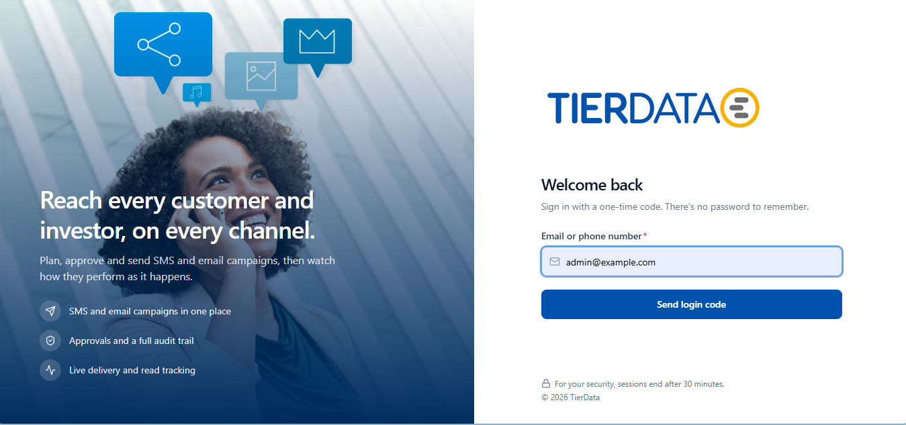
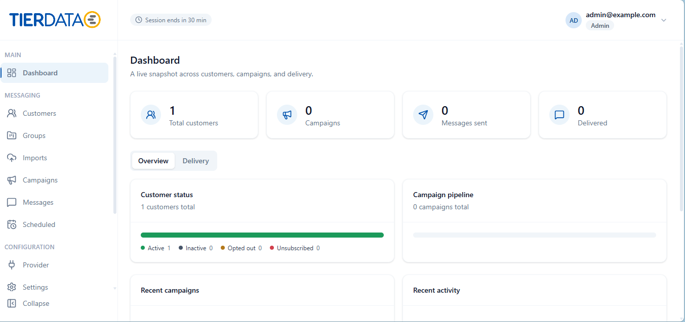
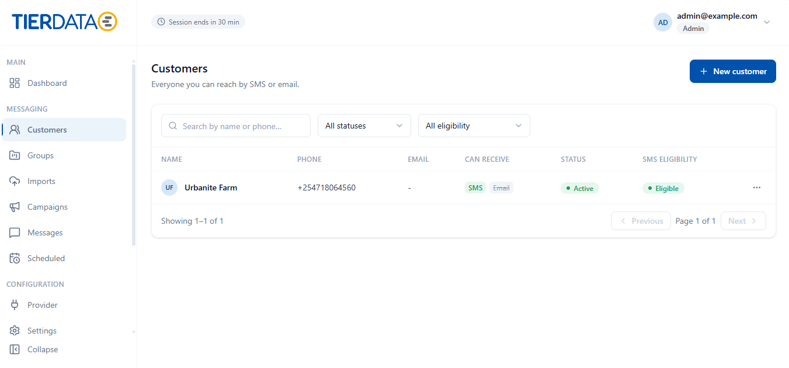
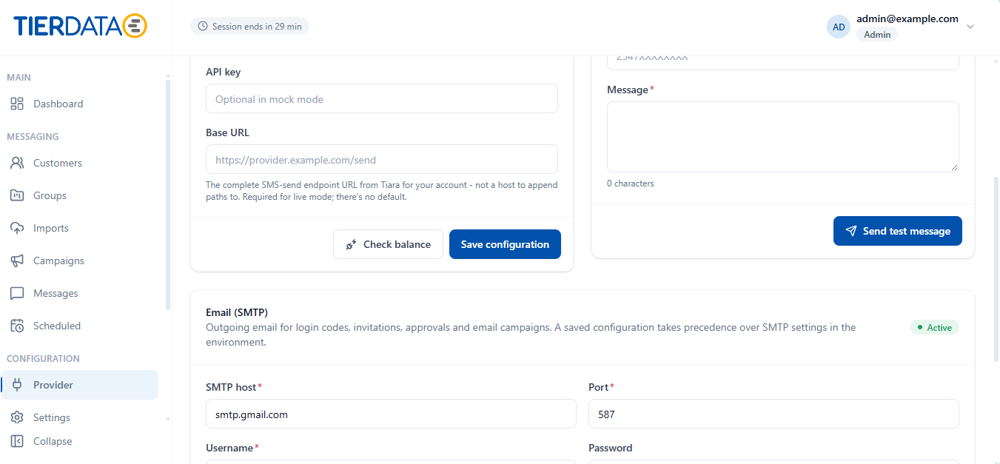
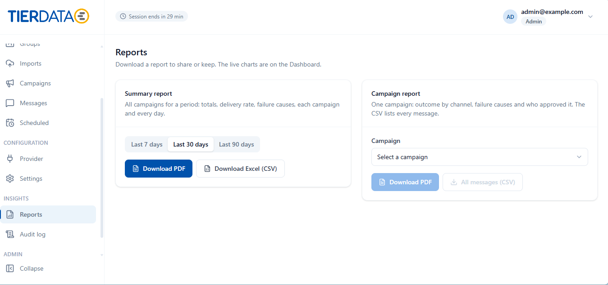
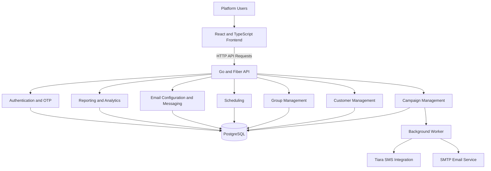

# TierData SMS
## Application Screenshots

### Homepage

### Dashboard

### Customer Management

### Provider Configuration

### Reports

**SMS & Email Campaign Management Platform**

TierData SMS is a messaging and customer communication management platform designed to help organizations manage contacts, organize audiences, create and schedule campaigns, and monitor message delivery.

The platform brings together SMS and email communication capabilities through a web-based interface and a Go-powered backend.

## Project Overview

The application provides a centralized environment for managing customer communication workflows.

Key platform capabilities include:

- **Campaign Management:** Create, manage, and organize messaging campaigns.
- **Customer Management:** Maintain customer contact records.
- **Group Management:** Organize contacts into groups for targeted communication.
- **Message Scheduling:** Schedule campaigns for future delivery.
- **SMS Integration:** Connect with the Tiara SMS provider.
- **Email Communication:** Support email messaging and SMTP configuration.
- **Campaign Approvals:** Support campaign approval workflows.
- **Delivery Tracking:** Track messaging activity and delivery information.
- **Reporting:** Generate campaign and messaging reports.
- **User Authentication:** Support secure user access and OTP workflows.
- **Audit Logging:** Maintain records of important application activities.

## Technology Stack

| Component | Technology |
|---|---|
| Backend language | Go 1.24 |
| Backend framework | Fiber v2 |
| Frontend framework | React 19 |
| Frontend language | TypeScript |
| Frontend build tool | Vite |
| Styling | Tailwind CSS 4 |
| Routing | React Router 7 |
| Database | PostgreSQL |
| PostgreSQL driver | pgx |
| PDF generation | go-pdf/fpdf |
| SMS integration | Tiara SMS |
| Email integration | SMTP |
| Version control | Git |

## System Architecture

The application follows a structured backend architecture, separating HTTP handling, application services, data persistence, and external integrations.

*This diagram is a conceptual representation of the application's major capabilities, not a complete deployment or runtime dependency specification.*

## Backend Organization

The Go backend is organized into separate application modules and platform components.

Some of the major functional areas include:

- Campaigns and campaign drafts
- Customers and contact groups
- Messaging and delivery workflows
- Scheduling and sender management
- Provider configuration
- Email configuration and email delivery
- Authentication, identity, and OTP
- Reporting and PDF generation
- Audit logging
- Background worker processing

The backend also includes database migrations, administrative commands, and dedicated test packages.

## Frontend Organization

The frontend is built with React and TypeScript.

Its source structure includes:

- API communication
- Dashboard components
- Reusable UI components
- Forms and tables
- Campaign pages
- Customer management pages
- Group management pages
- Reporting components
- Shared hooks and utilities

## Engineering Contributions

My contributions to the project have included backend development, frontend integration, email functionality, and application rebranding.

### SMTP Email Configuration

Worked on adding configurable SMTP email functionality to the existing platform.

Areas of involvement included:

- Integrating email configuration into the existing Provider section.
- Supporting SMTP configuration fields, including host, port, username, password, and sender address.
- Working on saving and retrieving email provider settings.
- Implementing email configuration testing functionality.
- Supporting test email functionality through the application's existing email infrastructure.

### Tier Data Rebranding

Contributed to updating the application's branding from Centum SMS CRM to Tier Data.

This included changes to the application identity, logo, and visual presentation.

### Backend and Integration Development

Worked within the Go and Fiber backend, contributing to application functionality, API handling, and integration with existing platform components.

### Testing and Quality

Worked with the project's Go test suite and email-related tests to validate functionality and identify integration issues.

## Engineering Experience

Working on this platform has provided practical experience in:

- Building features within an existing Go backend.
- Integrating frontend interfaces with backend APIs.
- Working with SMTP and external messaging providers.
- Managing PostgreSQL-backed application configuration.
- Organizing application code into modular components.
- Working with database migrations.
- Writing and troubleshooting automated tests.
- Using Git and collaborative development workflows.

## Project Context

TierData SMS is a collaborative company engineering project. The platform's overall architecture and functionality represent the work of the wider development team.

The contributions described here highlight my individual areas of involvement.

**Portfolio case study:** This repository contains project documentation only. It does not distribute the company's original source code, credentials, customer information, or confidential internal configurations.

---

**Developer Portfolio:** [https://portfolio-one-dusky-2p2jy5182c.vercel.app/]
