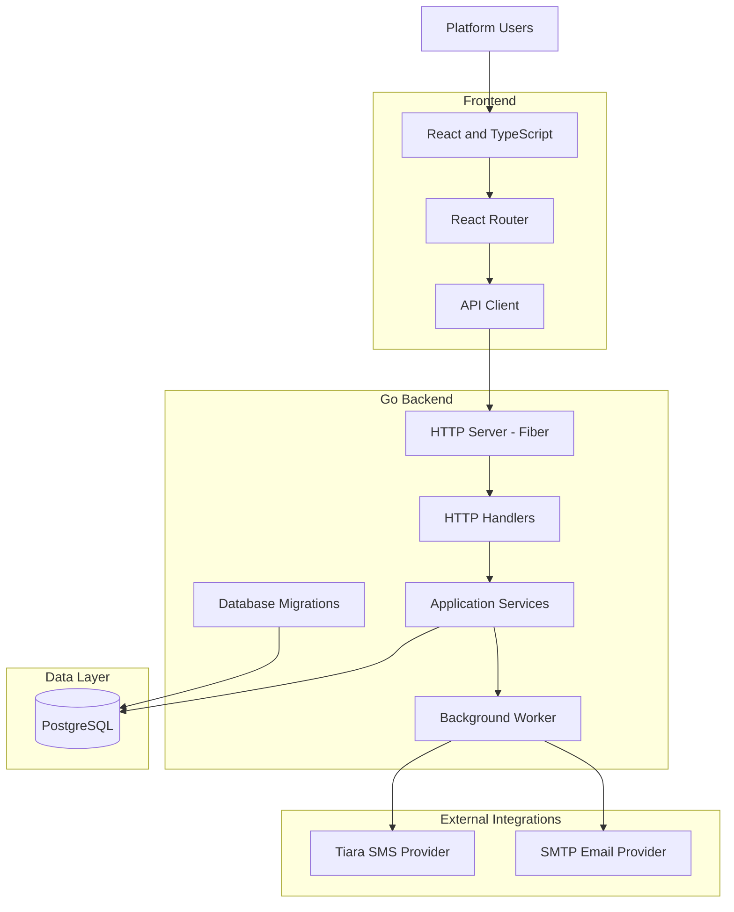

# TierData SMS — System Architecture

## 1. Overview

TierData SMS uses a web-based frontend backed by a Go application that exposes HTTP APIs and integrates with PostgreSQL and external messaging services.

The backend separates business capabilities into application modules, HTTP handlers, data stores, and supporting infrastructure.

## 2. High-Level Architecture

*Conceptual architecture based on the project's inspected structure. Actual execution paths and dependencies may vary by feature.*

## 3. Frontend

The frontend uses React 19 and TypeScript, with Vite as its development and build tool.

Its responsibilities include:

- Providing the user interface for messaging operations.
- Managing campaign, customer, and group workflows.
- Communicating with backend APIs.
- Presenting dashboards and reports.
- Providing reusable forms, tables, and interface components.

## 4. Backend

The backend uses Go 1.24 and the Fiber v2 web framework.

Its codebase is organized around functional modules, including:

| Module | Responsibility |
|---|---|
| Campaign | Campaign management |
| Campaign Draft | Campaign draft workflows |
| Customer | Customer records |
| Group | Contact organization |
| Messaging | Message workflows |
| Scheduling | Scheduled messaging |
| Sender | Sender management |
| Provider Configuration | Messaging provider settings |
| Email Configuration | SMTP configuration |
| Identity | User identity and authentication |
| OTP | One-time password workflows |
| Audit | Application activity records |
| Reporting | Reports and PDF generation |

## 5. Database Layer

PostgreSQL is used for persistent application data. The backend uses the pgx PostgreSQL driver.

Database schema changes are managed through versioned SQL migrations.

The migration history includes functionality for:

- User identity and sessions.
- Audit events.
- Customers and groups.
- Imports and sender configuration.
- Campaigns and messages.
- Scheduling and OTP.
- Email communication and tracking.
- Campaign approvals and personalization.
- Message retry backoff.
- Campaign attachments and drafts.
- Email provider configuration.

## 6. External Integrations

### SMS Provider

The application integrates with Tiara SMS for SMS messaging functionality.

### Email Provider

The application supports SMTP-based email functionality, including configurable email provider settings.

## 7. Background Processing

The backend includes a dedicated worker entry point for background processing.

This supports separating asynchronous processing responsibilities from the HTTP API process.

The exact job types and execution flow should be verified against the worker implementation before being documented in more detail.

## 8. Testing

The backend contains dedicated test packages covering application modules, HTTP handlers, persistence, migrations, provider integrations, email functionality, and worker components.

Testing is an important part of validating changes across the different application layers.

## 9. Architecture Summary

The platform combines:

- A React and TypeScript frontend.
- A modular Go and Fiber backend.
- PostgreSQL persistence.
- External SMS and SMTP integrations.
- Background processing.
- Versioned database migrations.
- Automated backend tests.

This architecture provides a foundation for managing customer communication and messaging workflows through a centralized application.
